# 3. Data model

Source of truth: `apps/api/prisma/schema.prisma` plus the hand-written SQL in `apps/api/prisma/migrations/*security*`.

## Entity-relationship overview

```mermaid
erDiagram
  users ||--o{ sessions : has
  sessions ||--o{ refresh_tokens : rotates
  users ||--o{ user_action_tokens : "verify / reset"
  users ||--o{ organization_memberships : "belongs to many orgs"
  users ||--o| platform_admins : "may be"
  platform_admins ||--o{ platform_admin_roles : ""
  platform_roles ||--o{ platform_admin_roles : ""
  platform_roles ||--o{ platform_role_permissions : ""
  platform_permissions ||--o{ platform_role_permissions : ""

  organizations ||--o{ organization_memberships : ""
  organizations ||--o{ branches : ""
  organizations ||--o{ roles : ""
  organizations ||--o{ organization_invitations : ""
  organizations ||--|| organization_subscriptions : ""
  roles ||--o{ role_permissions : "(role_id, organization_id)"
  permissions ||--o{ role_permissions : ""
  organization_memberships ||--o{ membership_roles : "(membership_id, organization_id)"
  roles ||--o{ membership_roles : "(role_id, organization_id)"
  branches |o--o{ membership_roles : "(branch_id, organization_id) NULL = org-wide"
  organization_memberships ||--o{ membership_permission_overrides : ""
  plans ||--o{ plan_prices : ""
  plans ||--o{ plan_entitlements : ""
  plans ||--o{ organization_subscriptions : ""

  organizations ||--o{ products : ""
  branches ||--o{ stock_balances : "(branch_id, organization_id)"
  products ||--o{ stock_balances : "(product_id, organization_id)"
  branches ||--o{ stock_movements : ""
  products ||--o{ stock_movements : ""
  organizations |o--o{ audit_events : "NULL = identity/platform event"
```

## Tables

| Domain | Table | Tenant | Key constraints / indexes |
|---|---|---|---|
| Identity | `users` | global | unique `email` (CHECK lower/trimmed); lockout counters; `password_changed_at` |
| | `user_credentials` | global, **ventidoc_auth only** | PK/FK `user_id`; argon2id `password_hash`; the app role has no privilege |
| | `sessions` | global | per device; `revoked_at`, `expires_at`, `reauthenticated_at` (step-up) |
| | `refresh_tokens` | global | unique `token_hash` (SHA-256); `used_at` for reuse detection |
| | `user_action_tokens` | global | unique `token_hash`; purpose = EMAIL_VERIFICATION / PASSWORD_RESET |
| Platform RBAC | `platform_permissions`, `platform_roles`, `platform_role_permissions`, `platform_admins`, `platform_admin_roles` | global | separate from org RBAC by table, registry and guard |
| Organizations | `organizations` | RLS (self) | unique `slug`; status ACTIVE/SUSPENDED |
| | `organization_memberships` | RLS | unique `(organization_id, user_id)`, unique `(id, organization_id)` |
| | `branches` | RLS | unique `(organization_id, code)`, unique `(id, organization_id)` |
| | `organization_invitations` | RLS | unique `token_hash`; bound to email; composite FK to role |
| Org RBAC | `permissions` | global, read-only to app | PK `key`; synced from code registry |
| | `roles` | RLS | unique `(organization_id, name)`; `is_system`, `template_key` |
| | `role_permissions` | RLS | PK `(role_id, permission_key)`; composite FK to role; FK to permissions |
| | `membership_roles` | RLS | composite FKs to membership, role, branch; unique `(membership_id, role_id, branch_id) NULLS NOT DISTINCT` |
| | `membership_permission_overrides` | RLS | GRANT/DENY, optional branch, mandatory reason, optional expiry |
| Subscriptions | `plans`, `plan_prices`, `plan_entitlements` | global | price = `amount_minor BIGINT` + `currency CHAR(3)` |
| | `organization_subscriptions` | RLS | one per org; status machine (see 05) |
| Audit | `audit_events` | RLS | append-only; indexes `(organization_id, occurred_at)`, `(actor_user_id, occurred_at)` |
| Inventory | `products` | RLS | unique `(organization_id, sku)`; archived, never deleted |
| | `stock_balances` | RLS | PK `(branch_id, product_id)`; `NUMERIC(18,3)`; CHECK ≥ 0 |
| | `stock_movements` | RLS | append-only; unique `(organization_id, idempotency_key)`; stores `balance_after` |

## Money and quantities

- Money: integer minor units (`BIGINT`) plus an ISO-4217 code. Never floats. Currency-specific exponents (e.g. JPY 0, BHD 3) will come from a currency table when sales are built.
- Stock: `NUMERIC(18,3)` handled with `Prisma.Decimal`; the API accepts and returns decimal **strings** and rejects exponent notation.

## History integrity

- Stock changes only happen through `StockService.adjust`, which writes a balance and a movement in the same transaction under a row lock. Corrections are new movements, never edits.
- Products, branches and memberships are archived or suspended rather than deleted; foreign keys from ledgers use `ON DELETE RESTRICT`.

## Migration strategy

1. Edit `schema.prisma` → `pnpm api prisma migrate dev --create-only --name <change>`.
2. **Review the SQL**. Delete any `DROP INDEX` of protected indexes, and add RLS policies and grants for any new tenant table in the same migration.
3. `pnpm api db:check-migrations` and the RLS test suite must pass. That suite fails if a table with `organization_id` lacks forced RLS.
4. Deploy with `prisma migrate deploy` as the migrator role, then `pnpm api db:seed` to sync catalogs. The API refuses to start if the permission catalog is behind the code.
5. Expand/contract for breaking changes: add nullable column → backfill → enforce → remove old column in a later release.
